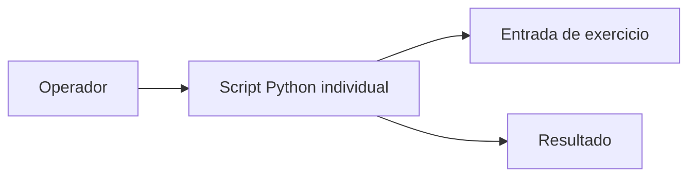

# Estrutura de exercícios — Atividade3-EdN

Não há backend, banco ou serviço empresarial no escopo identificado. Scripts: areaDeCircunferencia.py, calculadoraIMC.py, classificadorDeIdade.py, conversorTemperatura.py, verificadorAnoBissexto.py.
